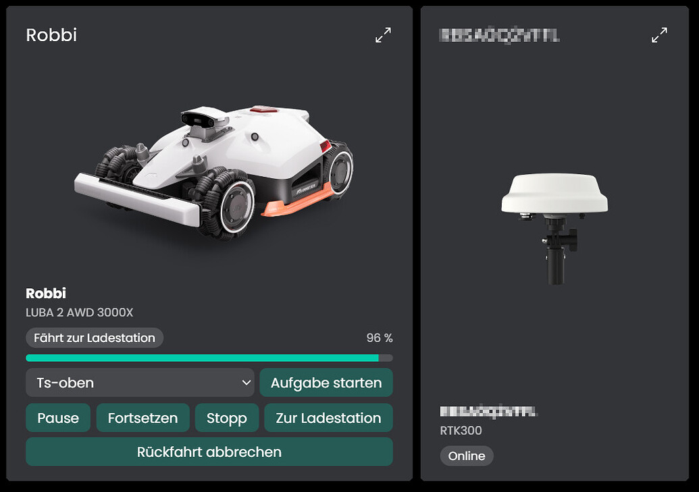

# Mammotion
Steuert Mammotion-Mähroboter (LUBA und YUKA) über die offizielle Mammotion Open API und zeigt ihren Zustand in IP-Symcon an.

## Inhaltsverzeichnis
- [Mammotion](#mammotion)
  - [Inhaltsverzeichnis](#inhaltsverzeichnis)
  - [Screenshots](#screenshots)
  - [1. Voraussetzungen](#1-voraussetzungen)
  - [2. Funktionsumfang](#2-funktionsumfang)
  - [3. Enthaltene Module](#3-enthaltene-module)
  - [4. Installation](#4-installation)
  - [5. Konfiguration in IP-Symcon](#5-konfiguration-in-ip-symcon)
  - [6. Spenden](#6-spenden)
  - [7. Lizenz](#7-lizenz)

## Screenshots

## 1. Voraussetzungen

* mindestens IPS Version 9.0
* Ein Mammotion-Konto mit mindestens einem Mäher, der in der Mammotion-App eingerichtet ist (Karte und Aufgaben werden dort angelegt).
* Entwickler-Zugangsdaten (Client-ID und Client-Secret) von [developer.mammotion.com](https://developer.mammotion.com). Die Zugangsdaten werden mit dem Mammotion-Konto erzeugt, das Secret wird nur beim Anlegen angezeigt.
* Die Mammotion Open API unterstützt laut Hersteller nur Mäher-Modelle, die 2025 erschienen sind.
* Live-Aktualisierung (Push) gibt es nur für das Modell LUBA 3 AWD.

## 2. Funktionsumfang
* Zustand, Akku, Ladestatus, Firmware und Netzwerk der Mäher anzeigen
* Mähen starten, pausieren, fortsetzen, stoppen und zur Ladestation schicken
* Aufgaben aus der Mammotion-App starten
* Arbeitsparameter (Betriebsart, Bahnmuster, Schnitthöhe, Hindernisvermeidung und weitere) anzeigen
* Fehlermeldungen des Mähers abrufen
* RTK-Referenzstationen mit Online-Zustand und Firmware anzeigen
* Live-Aktualisierung über die Cloud (nur LUBA 3 AWD)
* Kachel für die Kachel-Visualisierung mit Produktbild
* Den lokalen Zugang eines Mähers in der Mammotion-Cloud freischalten und abfragen

Die einzelnen Funktionen stehen bei den Instanzen unter "Enthaltene Module" und in der README des jeweiligen Moduls.

## 3. Enthaltene Module

* [MammotionCloud](MammotionCloud/README.md)
  * Verbindung zur Mammotion Open API: holt und erneuert das Token und führt alle Anfragen aus.
  * Hat als Verbindung einen Virtual IO, für die Live-Aktualisierung (nur LUBA 3 AWD) einen SSE-Client, den sie selbst einschaltet.
* [MammotionConfigurator](MammotionConfigurator/README.md)
  * Listet die Mäher des Kontos und legt die Geräteinstanzen an.
  * Legt RTK-Stationen als eigene Instanzen an und führt sie getrennt von den Mähern.
* [MammotionMower](MammotionMower/README.md)
  * Ein Mäher: Zustand, Steuerung, Aufgaben, Arbeitsparameter und Fehlermeldungen.
  * Kachel für die Kachel-Visualisierung mit lokal abgelegtem Produktbild, Zustand, Akku, Aufgabenauswahl und Steuerung.
* [MammotionRtk](MammotionRtk/README.md)
  * Eine RTK-Referenzstation: Modell, Firmware, Online-Zustand und Fehlermeldungen.
  * Kachel für die Kachel-Visualisierung mit lokal abgelegtem Produktbild.

## 4. Installation
Die Installation erfolgt über den IP-Symcon Module Store.

## 5. Konfiguration in IP-Symcon
1. Eine Instanz "MammotionCloud" anlegen.
2. Client-ID und Client-Secret eintragen, übernehmen und "Verbindung testen" drücken.
3. Eine Instanz "MammotionConfigurator" anlegen und über sie die gewünschten Mäher anlegen.
4. Beim Anlegen der MammotionCloud schlägt Symcon eine Verbindung vor: den Virtual IO anlegen lassen (Standard, schon aktiv). Nur für die Live-Aktualisierung des LUBA 3 AWD die Schnittstelle der Cloud auf einen SSE-Client ändern und beim Mäher "Abfrage und Live-Aktualisierung" einstellen. Die Cloud richtet den SSE-Client dann selbst ein.

## 6. Spenden
Dieses Modul ist für die nicht kommerzielle Nutzung kostenlos, Schenkungen als Unterstützung für den Autor werden hier akzeptiert:

 

## 7. Lizenz

[CC BY-NC-SA 4.0](https://creativecommons.org/licenses/by-nc-sa/4.0/)
